# Voting App on AWS EKS — Capstone 1 (Ship It)

## Overview

This project takes the Docker sample voting app (Cats vs Dogs) and ships it to AWS the way a real team would.
The app has five services: **vote** (Python/Flask) takes votes, **Redis** queues them, the **worker** (.NET) moves
them into **Postgres**, and **result** (Node.js) shows the live totals.

Around the app I built:

- **Hardened containers**: pinned base images, non-root users and `.dockerignore` files
- **Terraform** that creates an **Amazon EKS** cluster in the default VPC in **eu-north-1** and can destroy and recreate it
- A **GitHub Actions** pipeline that tests the app, scans every image with **Trivy**, pushes clean images to
  **GitHub Container Registry** tagged with the commit SHA, and deploys them with **Helm**
- A **Helm chart** with one values file, so a bad release can be rolled back with a single command

Every push to `main` is tested, scanned and deployed automatically, with no manual steps.

## Architecture

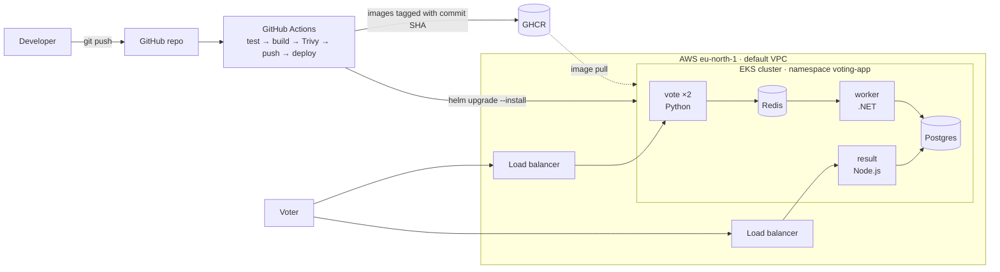

A vote travels **vote → Redis → worker → Postgres → result**. The vote page puts each vote on a Redis queue, the worker
takes it off and writes it to Postgres, and the result page reads the totals from Postgres and updates live.
Only **vote** and **result** are exposed to the internet, through AWS load balancers. Redis and Postgres are internal only.

## Repository layout

| Path | What it is |
|---|---|
| `vote/`, `result/`, `worker/` | The three app services and their hardened Dockerfiles |
| `docker-compose.yml` | Runs the whole app locally |
| `terraform/` | EKS cluster in the default VPC (eu-north-1) |
| `.github/workflows/ci.yml` | CI/CD pipeline: test → build → scan → push → deploy |
| `helm/voting-app/` | Helm chart for all five services, with one `values.yaml` |
| `docs/images/` | Screenshots used as evidence below |

## 1. Run locally

Requirements: Docker Desktop.

```bash
docker compose up --build
```

Vote: http://localhost:8080 · Result: http://localhost:8081 · Stop with `docker compose down`.

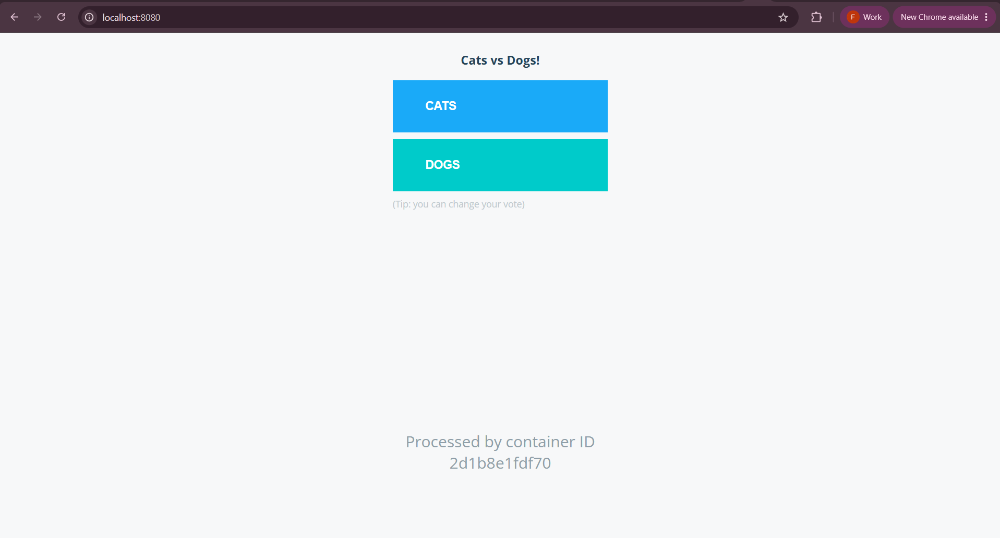

Lesson learned: port 8080 was already taken by a container from another project. I stopped it with `docker stop`,
then ran `docker compose down` and `up` again so the vote container was recreated with its network attached.

## 2. Secure containers

| Service | Base image (pinned by version + digest) | Runs as | `.dockerignore` |
|---|---|---|---|
| vote | `python:3.11.17-slim@sha256:e88e…` | `appuser` (uid 10001) | ✅ |
| result | `node:22.23.3-slim@sha256:c3de…` | `node` (uid 1000) | ✅ |
| worker | `dotnet/sdk:10.0.402` to build, `dotnet/runtime:10.0.13` to run (both with digests) | `app` (uid 1654) | ✅ |

- **Pinned digests**: every build uses exactly the same base image. A moving tag like `python:3.11` can change underneath you.
- **Non-root users**: if the app is ever compromised, the attacker gets a limited user, not root. The apps listen on
  **8080** because only root can open ports below 1024.
- **`.dockerignore`**: keeps `.git`, `.env`, caches and build output out of the images.
- **Supported runtimes**: result moved from Node 18 to **Node 22** and worker from .NET 7 to **.NET 10**, because the old
  versions no longer get security fixes.
- **Multi-stage build (worker)**: the large SDK image compiles the code, and only the small runtime image is shipped.

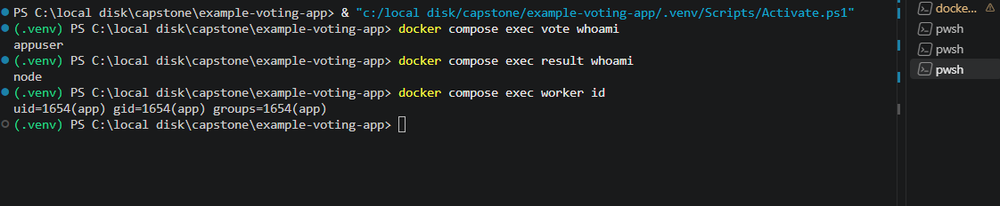

## 3. Infrastructure with Terraform

`terraform/` uses the community [terraform-aws-modules/eks](https://registry.terraform.io/modules/terraform-aws-modules/eks/aws)
module (v21) and creates:

- An **EKS 1.36** cluster in the **default VPC**, across 3 availability zones (eu-north-1a/b/c)
- A managed node group of **2 × t3.medium** nodes (Amazon Linux 2023)
- Core add-ons: VPC CNI, CoreDNS, kube-proxy, Pod Identity Agent
- A **KMS key** that encrypts Kubernetes Secrets at rest
- Control-plane logs in CloudWatch, kept for **7 days** to limit cost
- Cluster access: `capstone-admin` is cluster admin, and `github-actions-deployer` can only **edit inside the `voting-app` namespace**

```bash
cd terraform
terraform init
terraform plan      # preview, creates nothing
terraform apply     # about 15 minutes
aws eks update-kubeconfig --region eu-north-1 --name voting-app
terraform destroy   # run at the end of every working day
```

**Destroy and recreate.** The same code built the cluster (37 resources), destroyed it, and rebuilt it later
(39 resources, after adding the deployer's access entry).

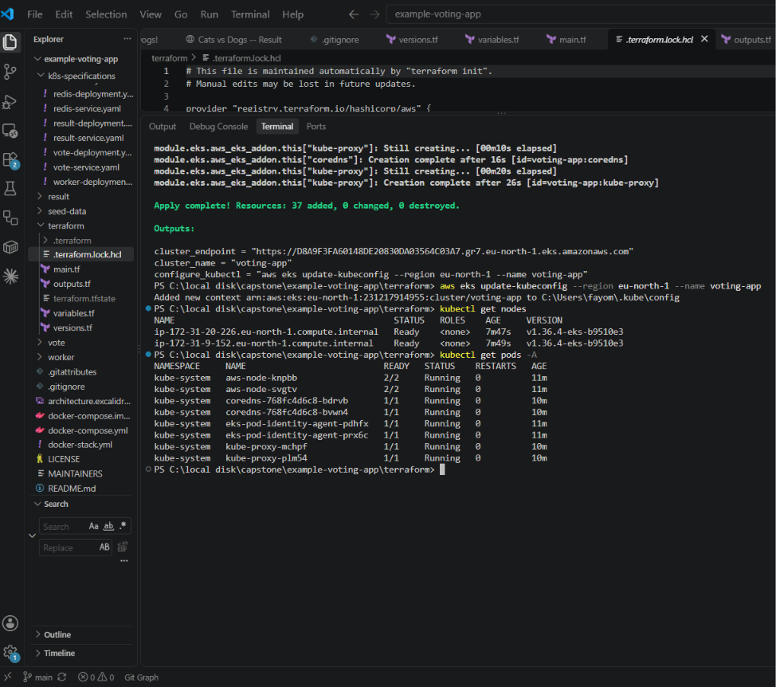

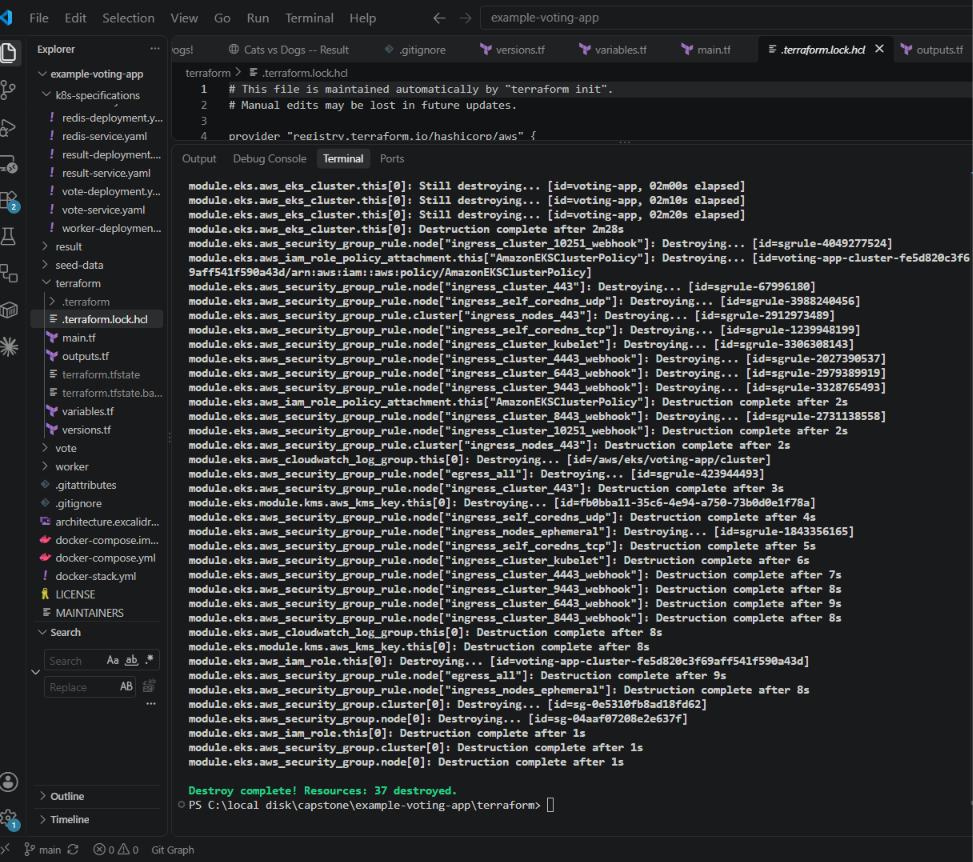

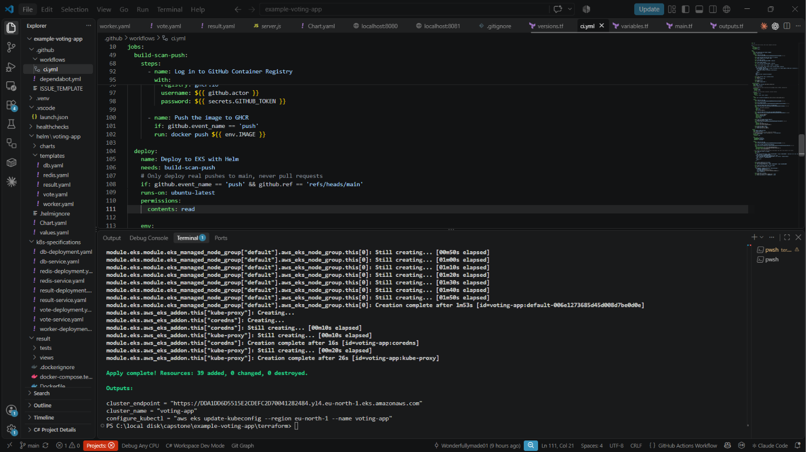

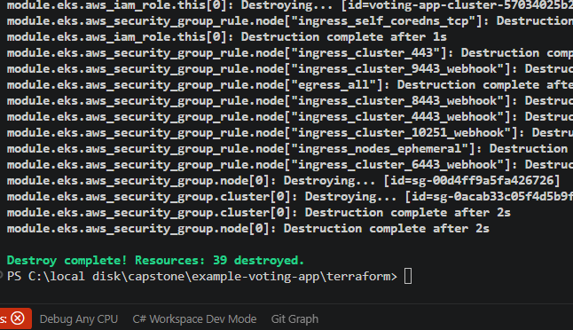

**Cost:** about $0.18/hour while running (EKS control plane plus two nodes), so the cluster is destroyed after every session.
The Terraform state stays local and is excluded from Git by `.gitignore`.

## 4. CI/CD pipeline

`.github/workflows/ci.yml` runs on every push and pull request to `main`:

1. **Test**: starts the whole app with docker compose, checks that both pages respond, submits a vote and waits until it
   reaches Postgres. This is a real end-to-end test of vote → Redis → worker → Postgres.
2. **Build, scan and push** (vote, result and worker in parallel): builds each image, scans it with **Trivy**, and only
   if the scan is clean pushes it to `ghcr.io/wonderfullymade01/<service>:<commit SHA>`.
   Trivy fails the job on any **HIGH or CRITICAL** vulnerability that has a fix available.
3. **Deploy**: logs in to AWS as `github-actions-deployer` and runs
   `helm upgrade --install … --set image.tag=<commit SHA>`. If the cluster is destroyed, the job skips the deploy with a
   warning instead of failing.

Pull requests are built and scanned but never pushed or deployed.

**Trivy blocked the first images.** The first full run failed all three scans:

| Image | Findings | Fix |
|---|---|---|
| vote | `wheel`, `jaraco.context` (2 HIGH) | Removed `setuptools`/`wheel`, which are only needed to install packages, not to run the app |
| worker | `Npgsql` 4.1.9 (HIGH), `System.Drawing.Common` (CRITICAL) | Upgraded Npgsql to 10.0.3, StackExchange.Redis to 2.13.17, Newtonsoft.Json to 13.0.4 |
| result | 7 Debian packages + 21 Node packages | `apt-get upgrade`, `npm audit fix`, and removed npm from the final image after use |

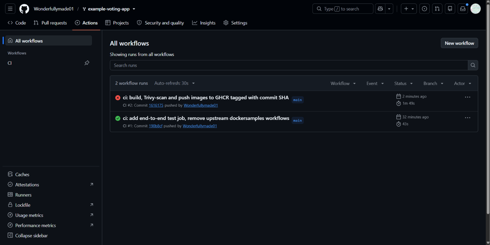

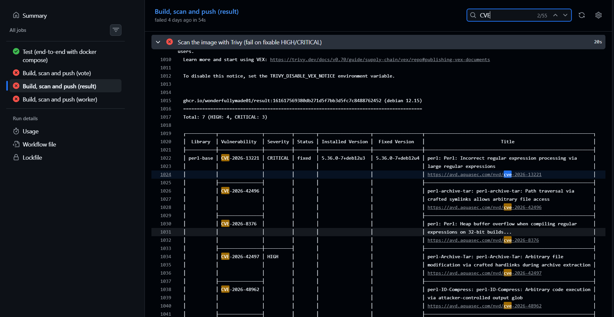

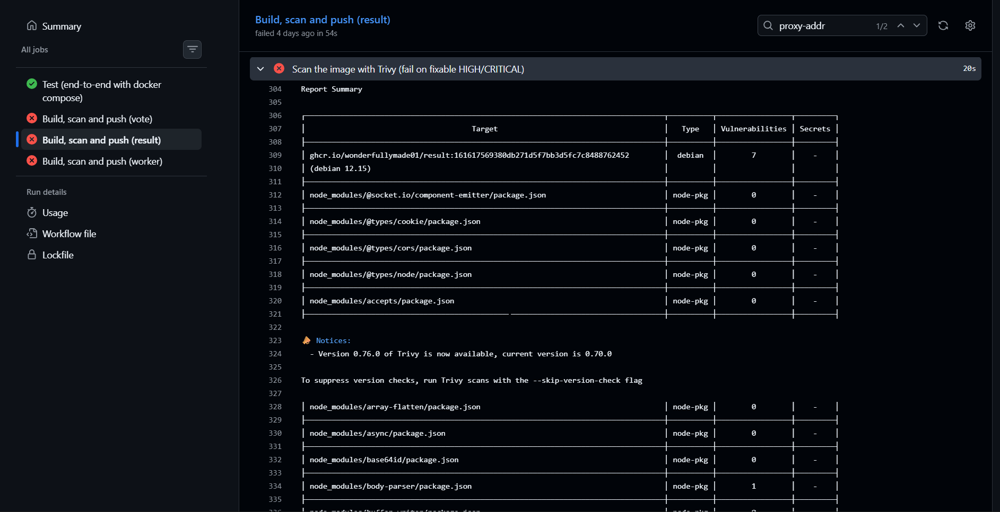

After the fixes, the whole pipeline is green, and the images are on GHCR tagged with the commit SHA:

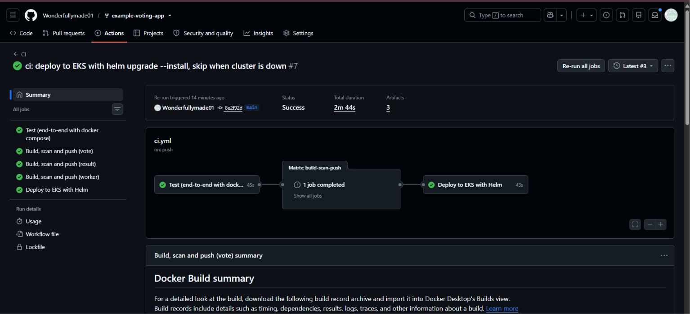

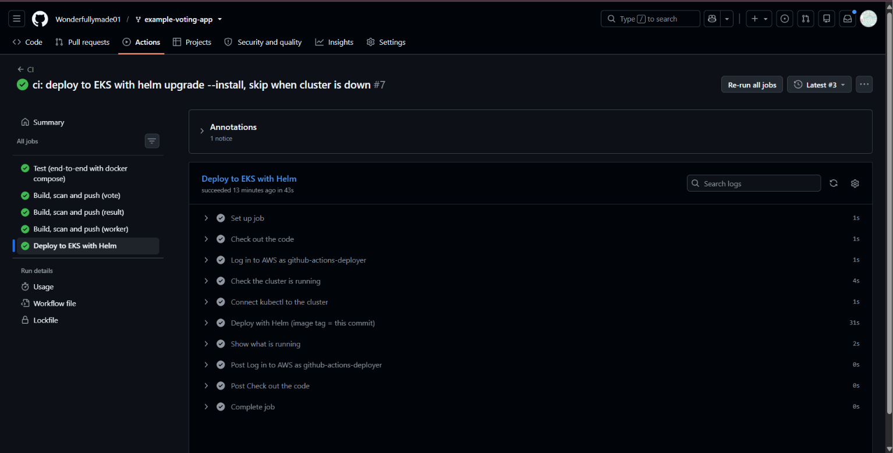

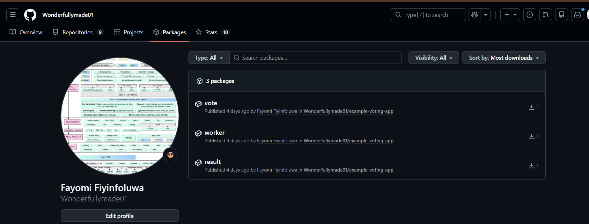

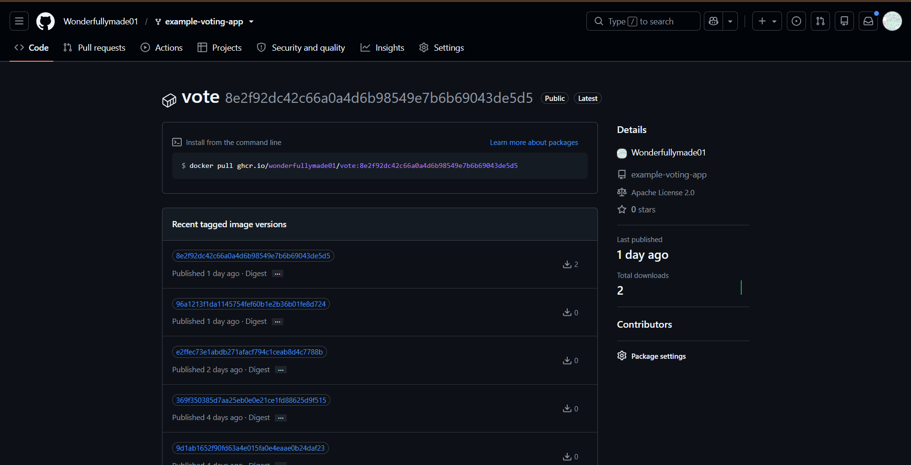

**Pipeline security**

- Every third-party action is **pinned to a full commit SHA**, not a tag, so a re-pointed tag can't inject code.
- The build job's token can only read code and write packages (`permissions: contents: read, packages: write`).
- The deployer has one AWS permission (`eks:DescribeCluster` on this cluster) and Kubernetes edit rights in
  one namespace only. A leaked key could not touch anything else in the account.

## 5. Deploy with Helm

`helm/voting-app/` is one chart for the whole app, driven by **one `values.yaml`** (image registry and tag, replicas, ports):

| Template | Creates |
|---|---|
| `redis.yaml` | Deployment + internal Service `redis` (Redis 8.10.2, pinned by digest) |
| `db.yaml` | Secret `db-credentials`, Deployment and internal Service `db` (Postgres 15.19, pinned by digest) |
| `worker.yaml` | Deployment (no Service, since nothing connects to it) |
| `vote.yaml` | Deployment (2 replicas) + `LoadBalancer` Service on port 80 |
| `result.yaml` | Deployment + `LoadBalancer` Service on port 80 |

- **Readiness and liveness probes**: a pod only gets traffic once it answers, and it's restarted if it stops answering.
- **`securityContext`**: Kubernetes enforces non-root (`runAsNonRoot`, the same user IDs as the images),
  blocks privilege escalation and drops all Linux capabilities.
- The DB password has no default. The chart refuses to install unless it is passed with `--set db.password=…`.

The pipeline deployed the app to EKS. The two screenshots show the two vote replicas (different container IDs)
behind the load balancer:

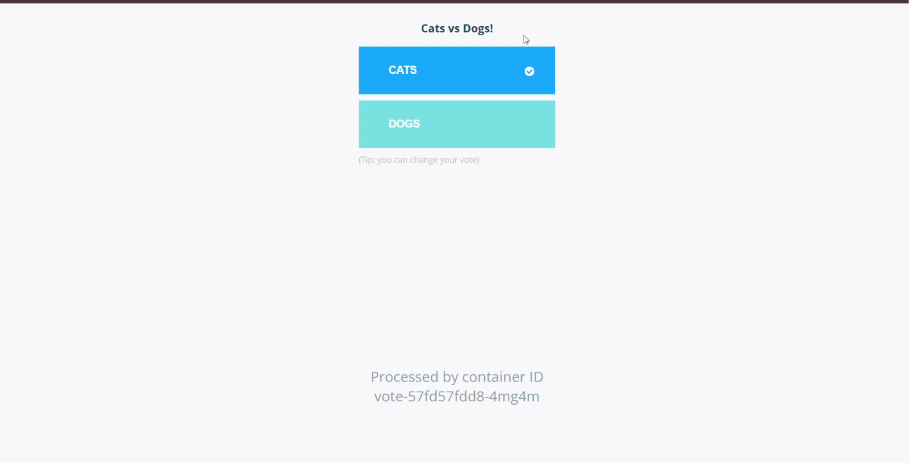

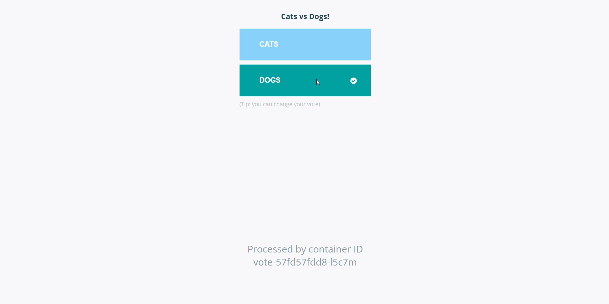

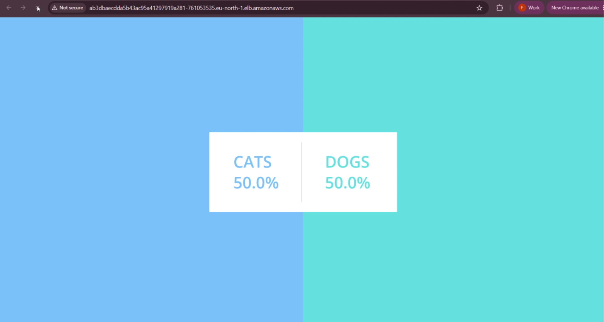

## Bad release and rollback

I shipped a release with an image tag that doesn't exist:

```bash
helm upgrade voting-app ./helm/voting-app -n voting-app --reuse-values \
  --set image.tag=this-tag-does-not-exist --wait --timeout 2m
```

The upgrade failed after 2 minutes. The new vote, result and worker pods were stuck in `ImagePullBackOff`
because the image was `not found` on GHCR. **The old pods kept running and serving users**, because the rolling
update only removes old pods once the new ones pass their readiness probe.

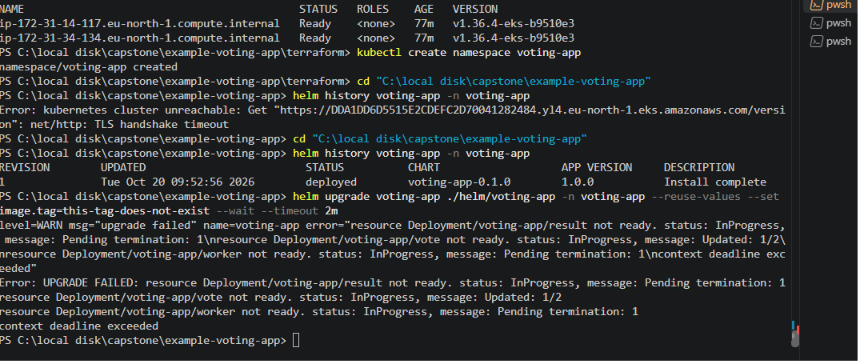

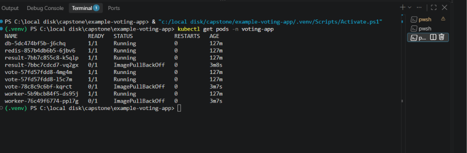

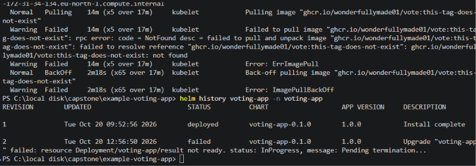

Rollback to the last good revision:

```bash
helm rollback voting-app 1 -n voting-app --wait
```

| Revision | Status | Description |
|---|---|---|
| 1 | superseded | Install complete (by the pipeline) |
| 2 | failed | Bad release |
| 3 | deployed | Rollback to 1 |

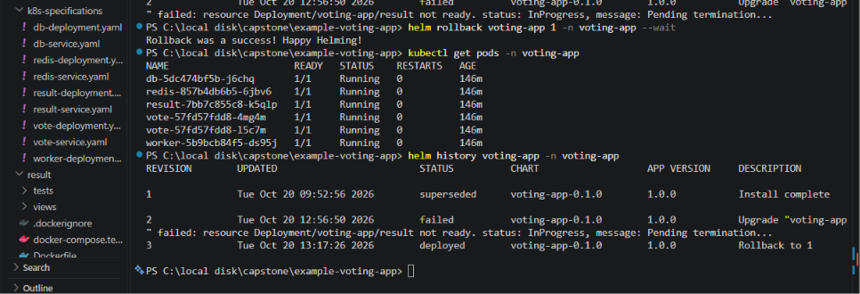

## Secrets

| Secret | Where it lives | Used by |
|---|---|---|
| `AWS_ACCESS_KEY_ID`, `AWS_SECRET_ACCESS_KEY` | GitHub Secrets (keys for the limited `github-actions-deployer` user) | Deploy job |
| `POSTGRES_PASSWORD` | GitHub Secret, passed to Helm, stored as the Kubernetes Secret `db-credentials` (encrypted with KMS) | Postgres |
| `GITHUB_TOKEN` | Created by GitHub for each run, then discarded | Pushing to GHCR |

No secrets are stored in Git. `.gitignore` excludes `.terraform/`, `*.tfstate*` and `*.tfvars`.

## Known limitations and next steps

- The sample app has the Postgres user and password **written into its code** (`postgres`/`postgres`), so the secret
  must match it. Next step: have result and worker read the password from an environment variable.
- Postgres and Redis use `emptyDir`, so **votes are lost if the pod restarts**. Next step: a PersistentVolumeClaim
  backed by EBS (needs the EBS CSI driver add-on).
- The load balancers serve **plain HTTP**. Next step: an ingress with a TLS certificate.
- The pipeline uses **stored AWS keys**, as the brief asks. Next step: GitHub OIDC, so there are no long-lived keys at all.
- The Terraform state is local. Next step: an S3 backend with locking, so a team can share it.

## Running the full cluster session

```bash
terraform -chdir=terraform apply
aws eks update-kubeconfig --region eu-north-1 --name voting-app
kubectl create namespace voting-app           # the deployer may only work inside it
# re-run the latest pipeline (or push a commit) to deploy
helm uninstall voting-app -n voting-app       # removes the AWS load balancers first
terraform -chdir=terraform destroy
```

## Credits

Based on [dockersamples/example-voting-app](https://github.com/dockersamples/example-voting-app).
